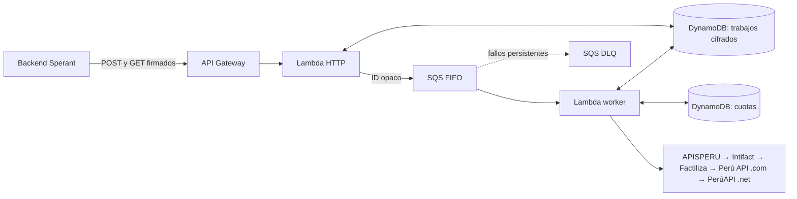

# Sperant DNI Lambda

Servicio interno para resolver nombres y apellidos a partir de un DNI peruano de ocho dígitos. API Gateway recibe la solicitud, SQS encola el trabajo y una Lambda consulta proveedores en orden hasta conseguir una respuesta válida. La API usa AWS IAM (SigV4). El cliente decide qué roles de Sperant pueden invocarla.



El módulo `service/src/dni` separa las reglas de identidad y cupos (`domain`), la resolución y gestión de trabajos (`application`), las integraciones con AWS y proveedores (`infrastructure`) y los adaptadores HTTP/SQS (`transport`). `bootstrap.mjs` conecta las capas. La infraestructura está en [template.yaml](template.yaml).

## Contrato

| Acción | Solicitud / respuesta |
| --- | --- |
| Encolar | `POST /v1/dni/lookups`, `Content-Type: application/json`, `Idempotency-Key: <UUID v4 en minúsculas>`, cuerpo `{"dni":"00000001"}`. Responde `202`, `Location` y `Retry-After`. |
| Leer | `GET /v1/dni/lookups/{id}`. Responde `202` con `Retry-After` mientras esté pendiente, o `200` con los nombres y apellidos si se resolvió. |
| Reintentar envío | Usa el mismo UUID y DNI tras un error transitorio en el POST. El mismo UUID con otro DNI devuelve `409` dentro del periodo de retención. |
| Sin resultados | `404 DNI_NOT_FOUND` si todos los proveedores activos indicaron que no encontraron el DNI. `503 PROVIDERS_UNAVAILABLE` si queda algún proveedor sin respuesta concluyente; puede incluir `retryAt`. Si el estado es terminal y quieres intentar de nuevo, usa otro UUID cuando corresponda. |
| Trabajo no accesible | `404 LOOKUP_NOT_FOUND` si el identificador no existe, venció o pertenece a otro rol. |

Ejemplo de resultado (datos ficticios):

```json
{
  "id": "8dafc251-9ea2-49d4-a60f-e9f9a9b2fd76",
  "status": "found",
  "data": {
    "nombres": "Ana María",
    "apellidoPaterno": "De la Cruz",
    "apellidoMaterno": null
  },
  "provider": "apisperu",
  "expiresAt": "2026-11-12T18:00:00.000Z"
}
```

Desde el backend, firma ambos requests con servicio `execute-api`, la región del stack y el rol de ejecución de Sperant. Da a ese rol solo `execute-api:Invoke` sobre `arn:aws:execute-api:REGION:ACCOUNT:API_ID/$default/POST/v1/dni/lookups` y `arn:aws:execute-api:REGION:ACCOUNT:API_ID/$default/GET/v1/dni/lookups/*`. Cada rol IAM es un límite de acceso; si varias organizaciones usan el mismo rol, Sperant debe aplicar el aislamiento entre ellas en su propio backend. Aplica espera y jitter al sondear estados, especialmente en lotes.

## Configuración y despliegue

Requiere Node.js 24 para el desarrollo y AWS SAM CLI compatible con `nodejs24.x` para desplegar. Las Lambdas usan los clientes SDK incluidos en el [runtime de AWS](https://docs.aws.amazon.com/lambda/latest/dg/lambda-nodejs.html).

1. Crea el secreto JSON del cifrado en AWS Secrets Manager, en la región y cuenta del stack, con la clave administrada por defecto del servicio. Usa el formato `{"current":"v1","keys":{"v1":"<32 bytes aleatorios en base64 estándar>"}}`. Genera los bytes con `openssl rand -base64 32` en un entorno privado. Para las llaves de los proveedores, elige uno de los dos métodos descritos abajo.
2. Si activas Perú API (.com), configura los parámetros `WorkerSubnetIds` y `WorkerSecurityGroupIds` con subredes privadas que salgan por **la misma IP elástica** a través de un NAT. Autoriza esa IP en el panel y verifica acceso HTTPS a los proveedores y a los servicios de AWS. Sin esa infraestructura, omite este adaptador. El stack puede generar cargos AWS, en especial si necesitas NAT.
3. Ejecuta `sam validate --lint`, `sam build` y `sam deploy --guided`. Usa el ARN completo en `KeyringSecretArn`. `AlarmTopicArn` puede apuntar a un SNS existente para avisos de la DLQ. El resultado `LookupUrl` contiene el endpoint.
4. En staging, habilita un proveedor primero y prueba un DNI autorizado. Confirma la firma, el resultado, las cuotas y el funcionamiento del segundo proveedor al simular que el primero no está disponible.

### Tokens de proveedores

- **Secrets Manager (recomendado en AWS):** crea un segundo secreto con el formato de [providers.example.json](docs/providers.example.json) e indica su ARN en `ProvidersSecretArn`. Incluye solo los proveedores confirmados con sus llaves reales. El orden de la lista es el orden de consulta. Si se configura este ARN, el worker usa exclusivamente el secreto.
- **Variables de entorno:** deja `ProvidersSecretArn` vacío y configura en **WorkerFunction** las variables de [.env.example](.env.example). Una variable de token vacía deja fuera a ese proveedor; el resto se usa en el orden mostrado arriba. Para desarrollo puedes guardar valores en un `.env` local excluido de Git y cargarlo con `node --env-file=.env`. AWS no lee ese archivo: configura las variables del worker mediante tu mecanismo de despliegue o en la consola y verifica que se conserven después de actualizar el stack.

Sin proveedores configurados, el resultado devuelve `503`. Guarda solo las llaves de API; las contraseñas de los portales no se usan en el servicio.

El uso recurrente y la promoción están detallados en [proveedores.md](docs/proveedores.md). No se crean, compran ni renuevan planes desde el stack.

## Operación y protección de datos

- SQS y su DLQ guardan identificadores opacos. DynamoDB guarda el DNI y los nombres cifrados con AES-256-GCM; el DNI se retira del registro al terminar. El resultado deja de estar disponible a las 24 horas. El [TTL de DynamoDB](https://docs.aws.amazon.com/amazondynamodb/latest/developerguide/TTL.html) hace la eliminación física de manera asíncrona.
- Los secretos de Secrets Manager se refrescan cada minuto. Para rotar el cifrado, conserva la clave anterior en el mapa, cambia `current` y retírala después de que hayan vencido todos los trabajos que podían usarla (24 horas más margen de caché y ejecuciones en curso).
- Los logs tienen 14 días y no incluyen DNI, nombres, tokens ni respuestas de proveedores. Usa los estados `auth`, `quota`, `rate_limit`, `temporary` y `invalid_response` para revisar una integración. Ante un fallo en la DLQ, corrige la causa y redirige el mensaje al origen mientras el trabajo siga vigente. Si venció, presenta uno nuevo.
- SQS puede entregar un mensaje más de una vez. El worker reclama cada trabajo mediante escritura condicional y no repite un trabajo terminado. Si falla después de llamar a un proveedor y antes de guardar el resultado, un reintento puede volver a consumir cupo. Los contadores se reservan antes de enviar el DNI y se comparten entre instancias del mismo stack.
- El backend debe contar con la base de tratamiento y autorización aplicables antes de enviar un DNI a terceros. Revisa los contratos de los proveedores, su retención y su procedencia conforme a la [Ley 29733 y su reglamento](https://www.gob.pe/institucion/anpd/normas-legales/6554453-16-2024-jus). Este servicio no acredita identidad ni reemplaza una verificación oficial.

## Pruebas locales

```sh
cd service
npm ci --ignore-scripts
npm run check
npm test
```

Pruebas sin red: contratos de cinco proveedores, fallos, cuotas concurrentes, promoción de 10.000 reservas, aislamiento por rol, idempotencia, retención y cifrado. No requieren credenciales ni usan DNI reales. Complementa con el despliegue de staging y una prueba autorizada antes de producción.
